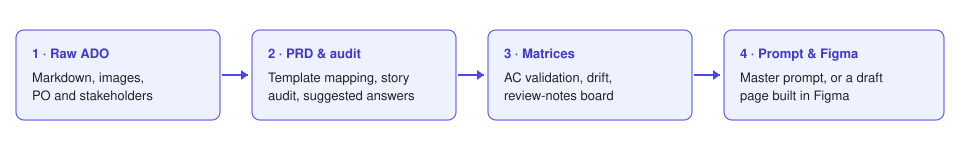

# ADO → Figma Spec Pipeline

Turn an Azure DevOps work item into everything a product designer needs before and after designing:

1. **Raw ADO ingestion** – paste the feature as Markdown (text, tables and screenshots), with Product Owner and stakeholders.
2. **Structured PRD & audit** – the work item mapped onto *your* PRD template, a readiness critique of every user story, the gaps to raise with the PO, and **suggested answers** for missing sections drawn from your earlier ADOs and from the AI acting as a UX designer. Export a PO review pack (copy or PDF).
3. **Validation & drift matrices** – an acceptance-criteria validation matrix, a market / design-system drift matrix and a review-notes board, all editable and exportable (Markdown / CSV).
4. **Prompt compiler & Figma** – one master prompt for any design or coding agent, or a **one-click draft page in Figma** that follows how your file already builds screens, handoff and documentation.

Every work item is kept in a history list so the team can come back to it.



---

## Run it

The app is a single HTML file. You can use it in two ways.

| | Claude artifact | Self-hosted page |
| --- | --- | --- |
| How | Publish `dist/artifact.html` as a Claude artifact | Serve `dist/index.html` (GitHub Pages, any static host, or open locally) |
| AI | Claude built in (your Claude account), or copy & paste with any agent | OpenAI-compatible, Anthropic, Gemini (your own key) or copy & paste |
| History & settings | Saved with the artifact (shared with whoever you share it with) | Saved in the browser (localStorage) |
| Images in ADOs | Stored as artifact assets | Stored with the work item |
| Build in Figma | Yes, through the Figma connector | Not directly: copy the master prompt into an agent that has the Figma MCP server |

### Build

```bash
npm install
npm run build        # writes dist/index.html and dist/artifact.html
npm run serve        # optional: preview dist/ locally
```

### GitHub Pages

The workflow in `.github/workflows/pages.yml` builds and deploys on every push to `main`. In the repository settings, set **Pages → Source** to **GitHub Actions**.

### As a Claude artifact

Publish `dist/artifact.html` as an artifact and grant these runtime capabilities:

| Capability | Why |
| --- | --- |
| `db` | Shared history of spec pipelines and workspace settings |
| `sample` (with images) | Claude analysis, suggestions and screen writing |
| `mcp` → server `Figma`, tool `use_figma` | Read the Figma file and build the draft page |
| `assets` | Screenshots pasted into ADOs |
| `downloads` | PDF, Markdown, CSV and design-system exports |

---

## Make it yours

Everything below is set in **Configuration & context** inside the app. Nothing is hard-coded to one company.

- **Product / platform name** – used in every prompt.
- **AI provider** – Automatic, Claude (built in), OpenAI-compatible (OpenAI, Azure OpenAI, OpenRouter, Ollama, LM Studio…), Anthropic, Gemini, or **Any agent (copy & paste)**. API keys stay in your browser and are never saved with the workspace.
- **PRD template** – upload your own `.docx`, `.md` or `.txt`; sections are detected from numbered headings (`2.1 Product Overview`). A neutral starter template is included.
- **Design system slots** – create as many slots as you need (for example “Brand 100% strict” and “Product hybrid”), upload any number of packages (`.zip` of Markdown/JSON, or single files) into each, choose how strictly each slot applies, and download a slot back as `.zip`. An example package lives in [`examples/design-system`](examples/design-system).
- **Figma target, source of truth and sitemap** – sync journey nodes (`J1`, `J1.2.1`, …) from your file's page list, or paste them.
- **Matrix style guide** – the format of the review-notes board.

### How “Build in Figma” works

1. **Read the file** (read-only): the page list, the selected journey page and a reference page you choose. It learns the screen shell, the library components in use, text styles, colour variables, the handoff card layout and the feature card.
2. **New page**: `↳ {node id} - {area} - {feature} [Draft]`, placed **below the selected journey node**, ordered by number among the node's existing sub-pages.
3. **Generate** (in the background): the AI plans 8–14 screens, then writes and builds them three at a time by cloning your shell and reusing your library components; a Handoff section and a Comparison section follow. You can keep working on other screens or ADOs while it runs; a header chip shows progress, and actions that would interrupt it ask for confirmation. Failed batches clean up after themselves and can be resumed.

Requires the Figma MCP server's `use_figma` tool (write access, beta): a Figma plan that includes it and edit access to the target file.

---

## Project structure

```
src/
  app.jsx            App shell, history store, background jobs, AI bridge
  step1.jsx          Raw ADO ingestion (Markdown editor, stakeholders)
  steps23.jsx        Structured PRD & audit, suggestions, matrices, review board
  step4.jsx          Prompt compiler and the Figma panel
  drawer.jsx         Configuration: AI, PRD template, design-system slots, Figma
  ai.js              Provider-agnostic AI layer
  engine.js          Analysis prompt, local rules engine, exports
  suggest.js         History-based and AI suggestions
  figma-*.js         Figma file reading, page building and the background runner
  jobs.js            Background job store
  store.js           Persistence (artifact database or localStorage)
  sample/            Neutral starter content: PRD template, example design system, demo work item
examples/design-system/   The example design-system package as files
scripts/build.mjs    Single-file build
```

## Privacy

- API keys: browser only (localStorage), never in the workspace data.
- Self-hosted: work items and settings stay in the browser unless you export them.
- Claude artifact: work items and settings are stored with the artifact and visible to the people you share it with.

## License

MIT
